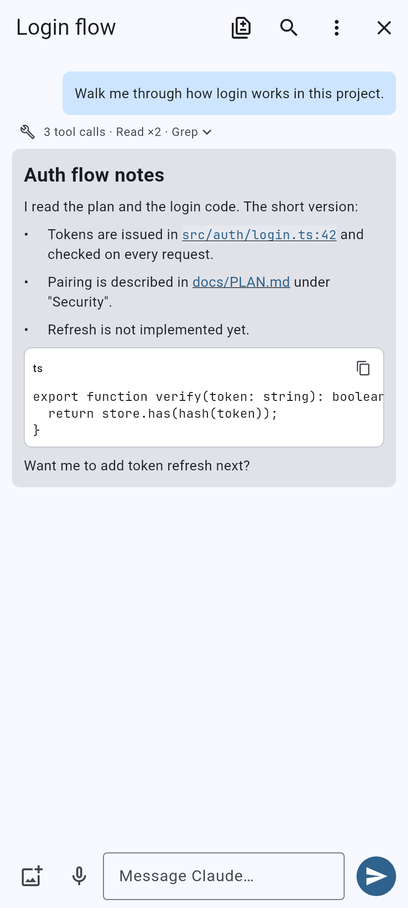
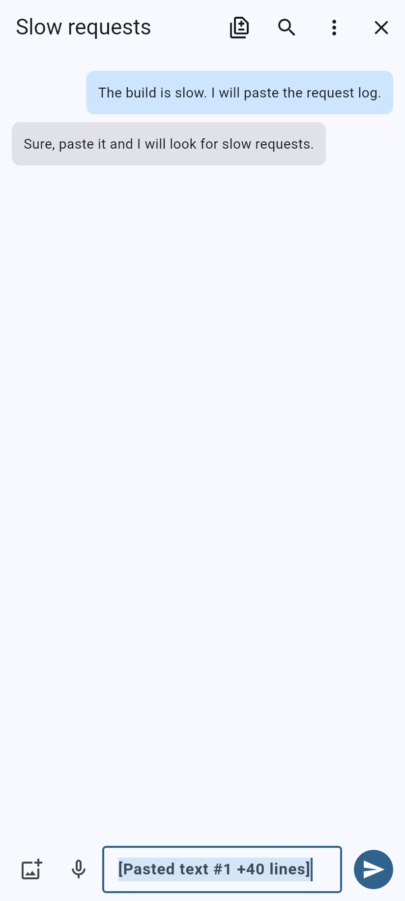
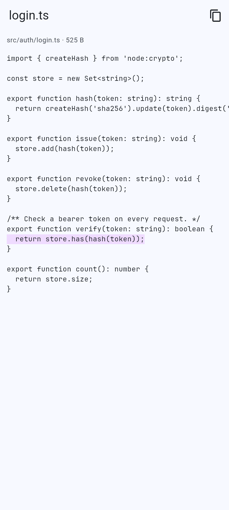
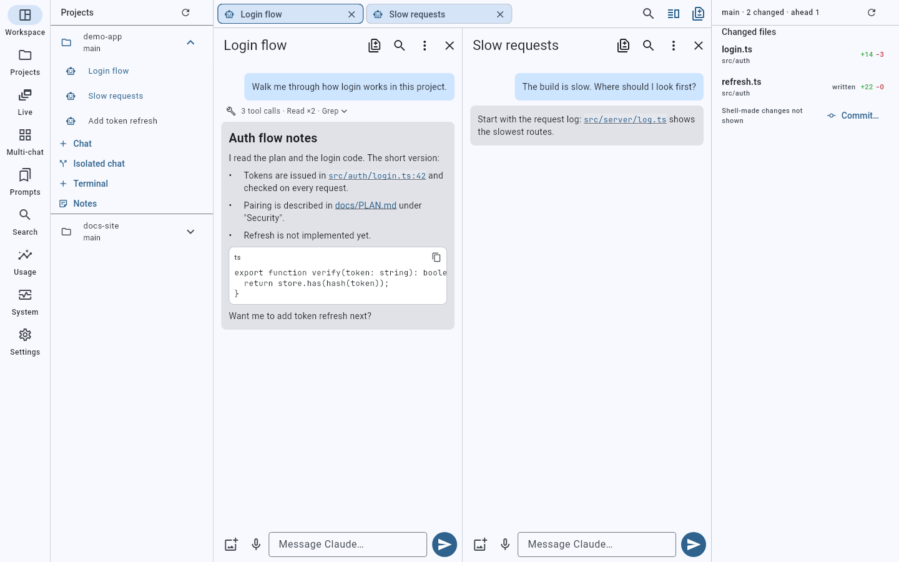

# VibeMobile

Run your software projects, terminals and [Claude Code](https://claude.com/claude-code)
sessions on a home Linux server, and drive them from your phone or desktop over a
private [Tailscale](https://tailscale.com) network.

- **Android app** and **Windows desktop app** (one Flutter codebase).
- **`vibe-daemon`** on the server (Node + TypeScript). It holds the sessions, so they keep
  running when your phone sleeps, roams between WiFi and cellular, or the app closes.
- **No public endpoint.** The daemon binds to localhost only; `tailscale serve` is the
  only way in, and every device has to be paired.

> Status: personal project, in daily use. Milestones M0–M5 and the desktop track are
> built; hardening (M6) is ongoing. Progress: [`docs/milestones.md`](docs/milestones.md).

## Features

**Claude Code sessions**
- Native chat UI on the Claude Agent SDK, with several sessions per project, resumable
  transcripts, and Claude Code sessions started outside the app mirrored in.
- Approve or deny permissions with a diff preview. Modes: Ask / Auto-allow / Plan. "Approval
  needed" jumps you to the pending request.
- Stop or interrupt a turn, retry or edit the last turn, branch a conversation, and rewind
  a turn's file edits (checkpoints).
- Live turn status, a context meter with manual compaction, reasoning-effort control, model
  switching in the middle of a session, and collapsible thinking blocks.
- Composer: voice input, image and screenshot attachments (including clipboard paste on
  desktop), `@file` completion, prompt insert, and Claude Code skills and slash commands.
- Markdown rendering (code blocks, tables, links), folded tool runs, tool output, message
  copy, and transcript copy or share.
- Message search, rename and tag sessions, session templates, scroll-to-bottom with an
  unread count.
- A git worktree per session, if you want one. Session-to-session messaging (`vibe-peers`
  MCP tools). MCP server view. Scheduled prompts.

**Terminal**
- Full terminal (`xterm`) on a `tmux`-backed PTY that survives disconnects, plus an extra
  key row for mobile.

**Projects and dashboard**
- Project grid with status, a session switcher, a multi-chat grid, and project notes (the
  idea inbox).
- New project from a scaffold. Project cockpit with activity, cost, devices and the audit log.
- Prompt library with variables, reusable across projects, plus prompt history and "Improve
  prompt".

**Files and git**
- Changed-files sheet with diffs. A read-only file browser confined to the project, with
  secrets and `.git` hidden.
- Git status and commits, and pull request / CI status (read-only).

**Desktop workspace** (Windows)
- Navigation rail, sidebar, tabs, split view, a changes pane, and a Ctrl+K command palette.
- Model registry covering the major providers, plus agent CLI presets and hand-off.
- Token and cost dashboard, a read-only system monitor, and an always-on Claude plan usage
  meter.

**Notifications**
- Push notifications (FCM) when a session finishes or needs you, with deep links straight
  into it.

Per-feature docs: [`docs/proposals/`](docs/proposals/README.md).

## Architecture

```
phone / desktop (Tailscale on) ──► https://<machine>.<tailnet>.ts.net   (tailscale serve)
                                    └─► 127.0.0.1:8787  vibe-daemon (localhost only)
                                          ├─ auth: device pairing + bearer token
                                          ├─ SQLite: devices, projects, sessions, events
                                          ├─ Claude Agent SDK sessions (+ native multi-provider engine)
                                          ├─ scanner: projects under the configured roots
                                          └─ tmux -L vibe: durable terminal sessions
```

- **Client** (`app/`): Flutter, Riverpod, `xterm`, `dio`, `web_socket_channel`,
  `flutter_secure_storage`, FCM.
- **Daemon** (`vibe-daemon/`): Node + TypeScript, Fastify + `@fastify/websocket`,
  `better-sqlite3`, `node-pty`, `@anthropic-ai/claude-agent-sdk`, run with `tsx`.
- **Transport**: Tailscale ([ADR 0005](docs/decisions/0005-tailscale-transport.md)).

## Quick start

### Daemon (Linux server)

Requires Node 20+, `tmux`, Tailscale, and a logged-in `claude` CLI.

```bash
cd vibe-daemon
npm install
npm test          # full suite, including a real-tmux reattach test
npm start         # http://127.0.0.1:8787 (localhost only)
npm run pair:new  # prints a one-time pairing code for a new device
```

Expose it to your tailnet (one time, no public port):

```bash
tailscale serve --bg 8787   # https://<machine>.<tailnet>.ts.net → 127.0.0.1:8787
```

To run it as a systemd user service, see [`vibe-daemon/deploy/`](vibe-daemon/deploy/).

Useful environment variables: `VIBE_PROJECT_ROOTS` (comma-separated folders the scanner
walks; default is your home folder), `PORT`, `VIBE_DB`, `VIBE_MAX_CLAUDE` (concurrent
Claude sessions).

### App

Requires the Flutter SDK. Android builds also need the Android SDK and JDK 17; Windows builds
need Visual Studio with the C++ desktop workload.

```bash
cd app
flutter pub get
flutter test
flutter run                      # connected device
flutter build apk --release      # Android → build/app/outputs/flutter-apk/
flutter build windows --release  # Windows → build/windows/x64/runner/Release/
```

On first launch, enter the daemon URL (`https://<machine>.<tailnet>.ts.net`) and a pairing
code from `npm run pair:new`.

## Screenshots

Generated headless from Flutter widget tests with fake data (`scripts/screenshots.sh`); the full set is in
[`docs/screenshots/`](docs/screenshots/README.md).

  



## Security

This app exposes a shell and coding agents over the network, so security comes first:

- The daemon never binds beyond `127.0.0.1`; the only ingress is `tailscale serve`.
- Every request carries a paired device token. Pairing needs physical access to the server
  (the code is printed there), and each device can be revoked on its own.
- Rate limits and an audit log for executed commands. File reads are confined to the project,
  with secrets and `.git` never served.

Checklist and live status: [`docs/security.md`](docs/security.md).

## Docs

`docs/` is the source of truth:

| Path | What |
|------|------|
| [`PLAN.md`](PLAN.md) | Goal, architecture, milestones |
| [`docs/milestones.md`](docs/milestones.md) | Progress per milestone |
| [`docs/proposals/`](docs/proposals/README.md) | One doc per feature |
| [`docs/decisions/`](docs/decisions/README.md) | Architecture decision records |
| `docs/protocols/` | Wire specs (WebSocket and REST) |
| [`docs/WORKFLOW.md`](docs/WORKFLOW.md) | How work is tracked in this repo |
| [`CLAUDE.md`](CLAUDE.md) | How Claude works in this repo |
