# Workflow screenshots

Generated by `scripts/screenshots.sh` (proposal 50). Do not edit by hand.

## Chat overview

### phone

*01. Conversation*

## Copy selection

### desktop

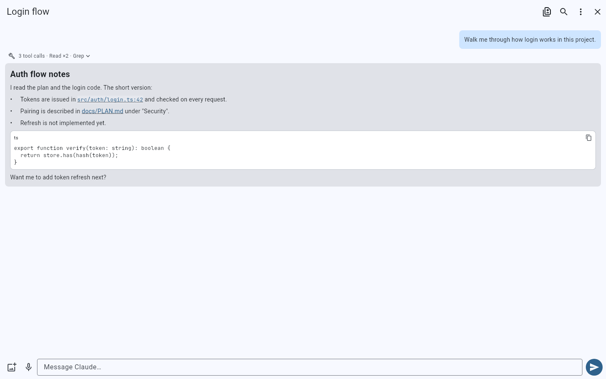

*01. Reply*

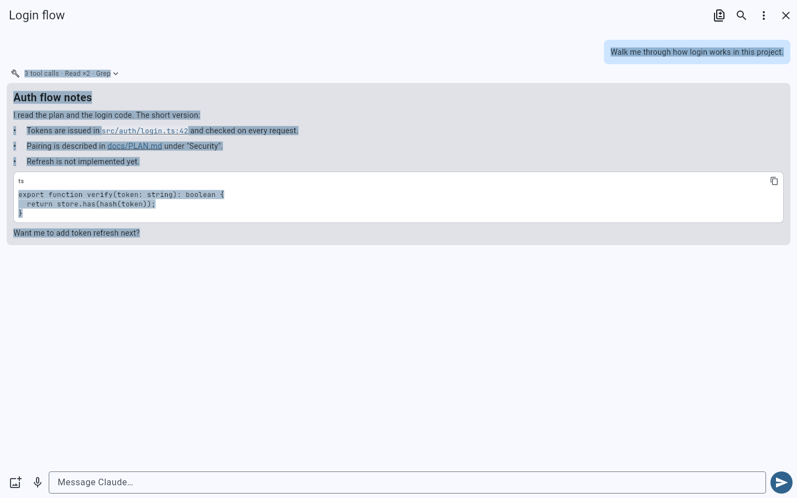

*02. Selected*

## Desktop workspace

### desktop

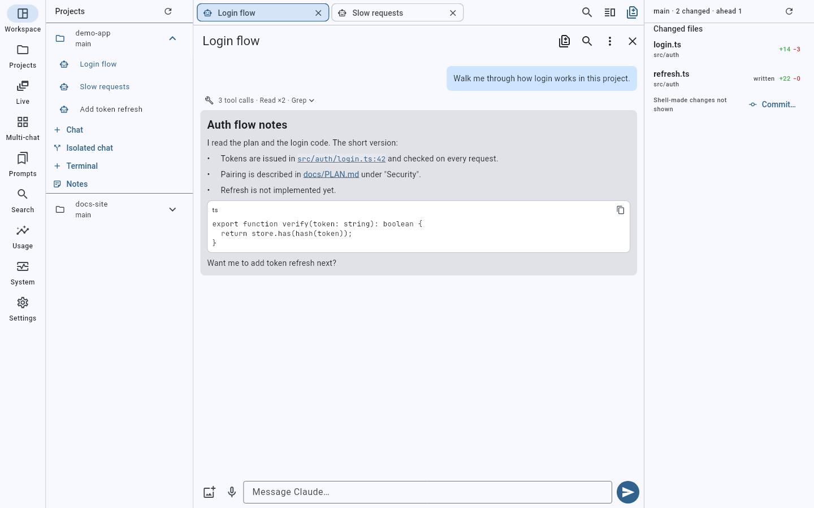

*01. Sidebar and tabs*

*02. Split view*

### desktop-compact

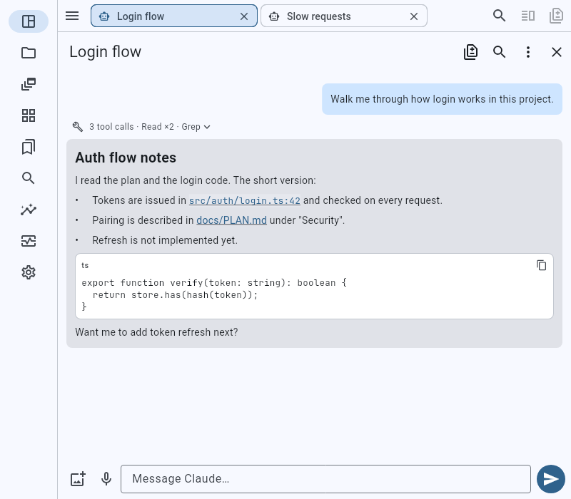

*01. Icon rail*

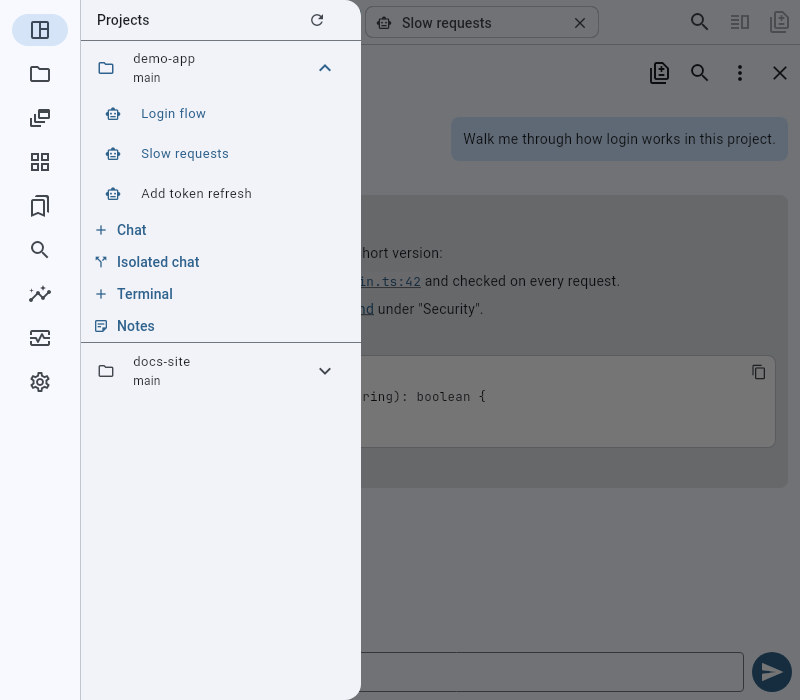

*02. Sidebar drawer*

## File links

### phone

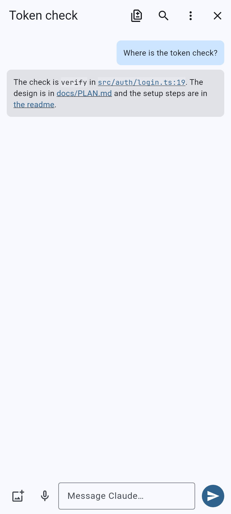

*01. Links in reply*

*02. Viewer at line*

### desktop

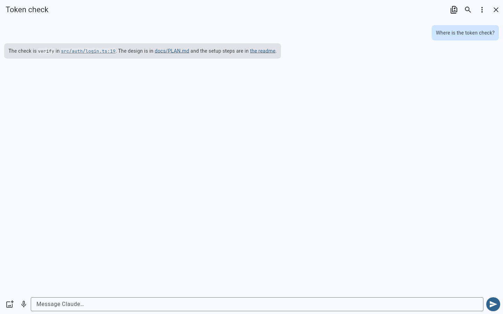

*01. Links in reply*

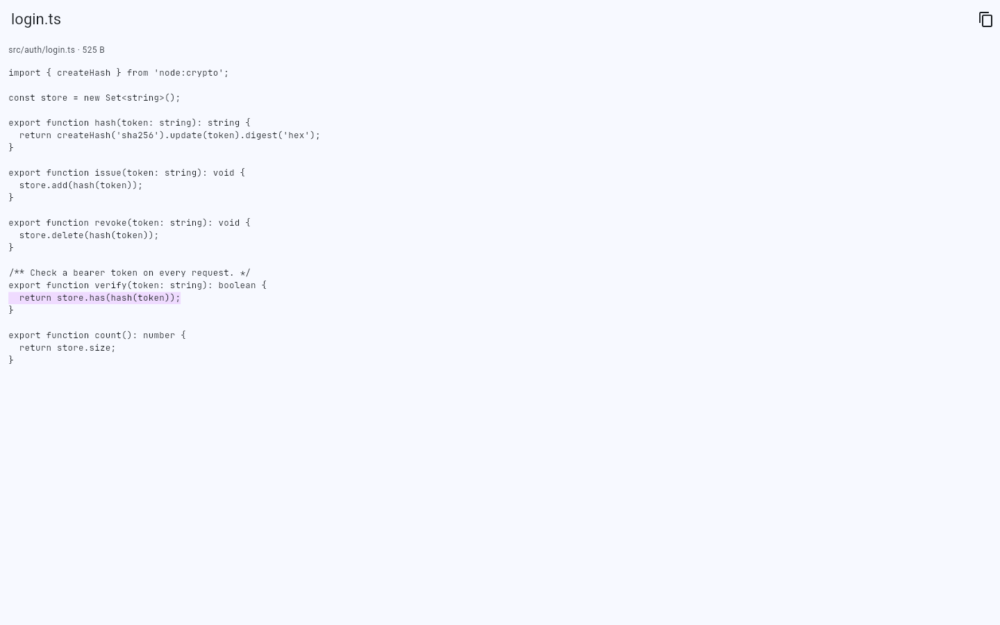

*02. Viewer at line*

## Paste collapse

### phone

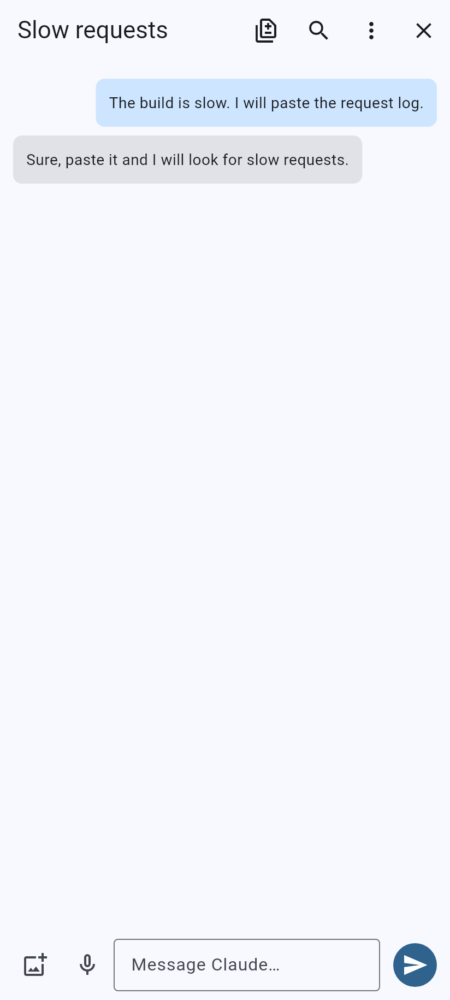

*01. Composer empty*

*02. Pasted chip*

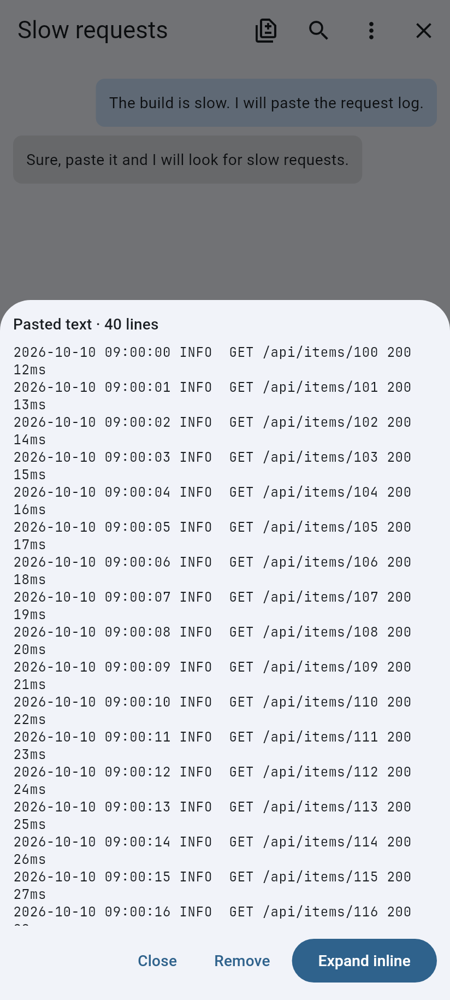

*03. Chip sheet*

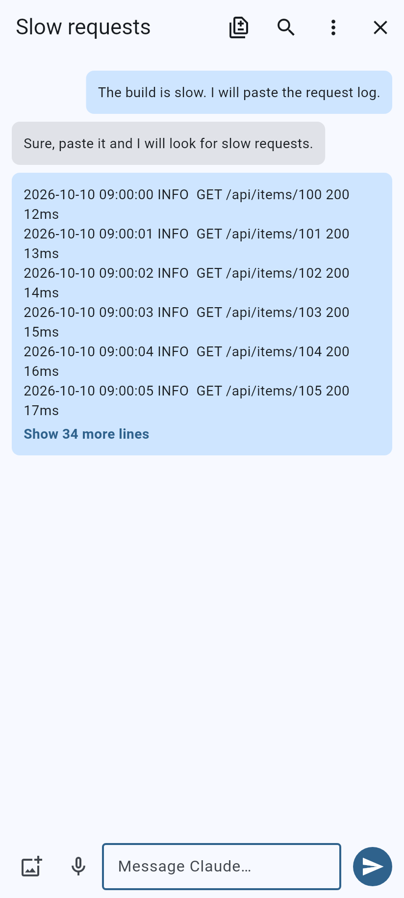

*04. Sent folded*

### desktop

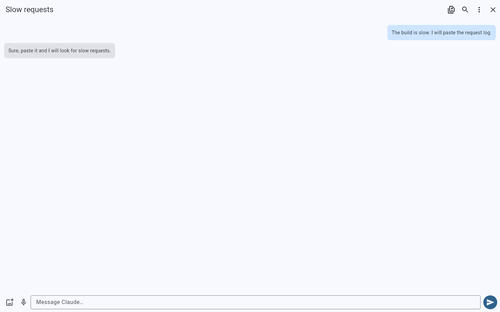

*01. Composer empty*

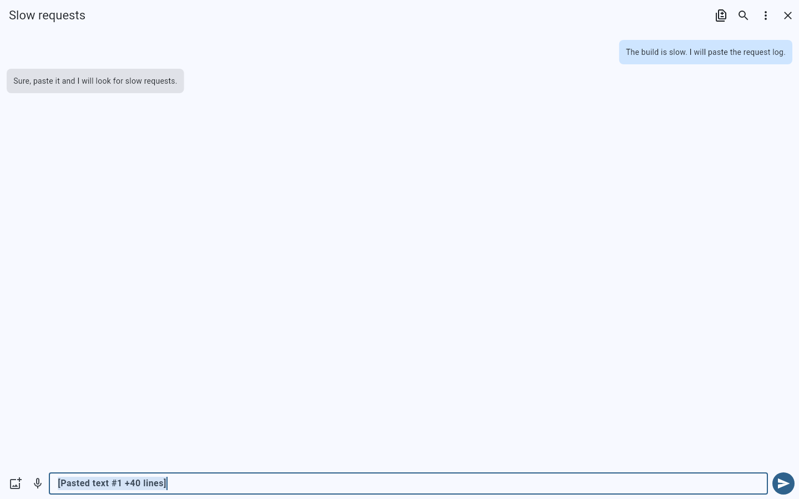

*02. Pasted chip*

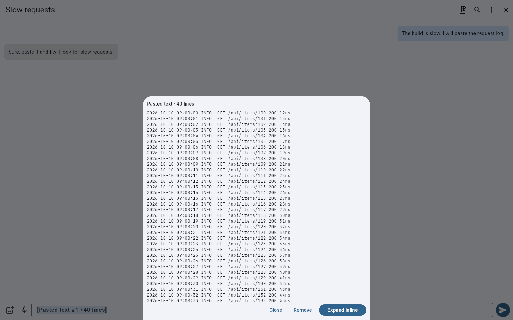

*03. Chip sheet*

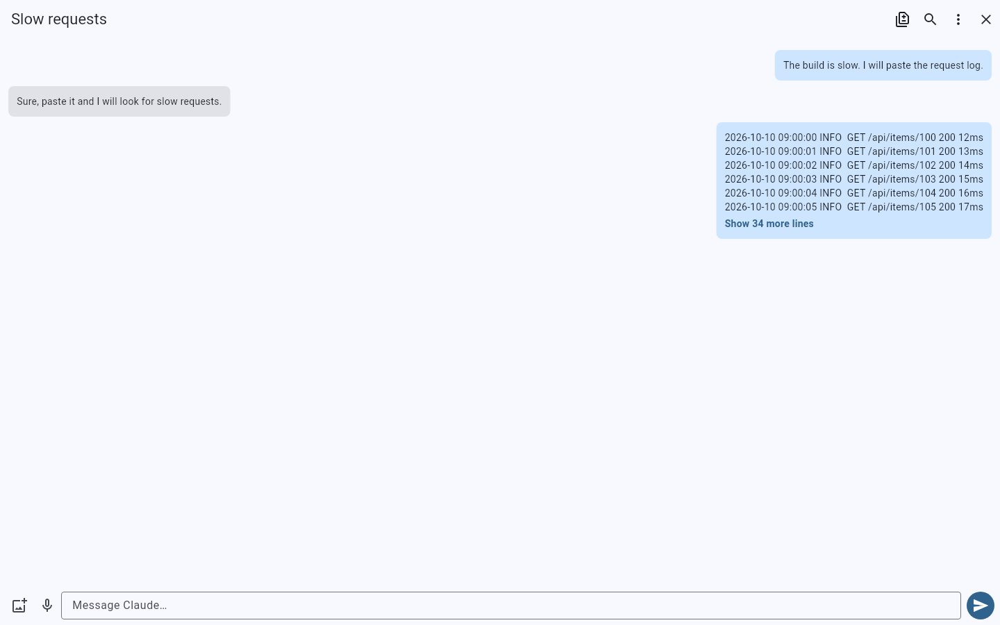

*04. Sent folded*

